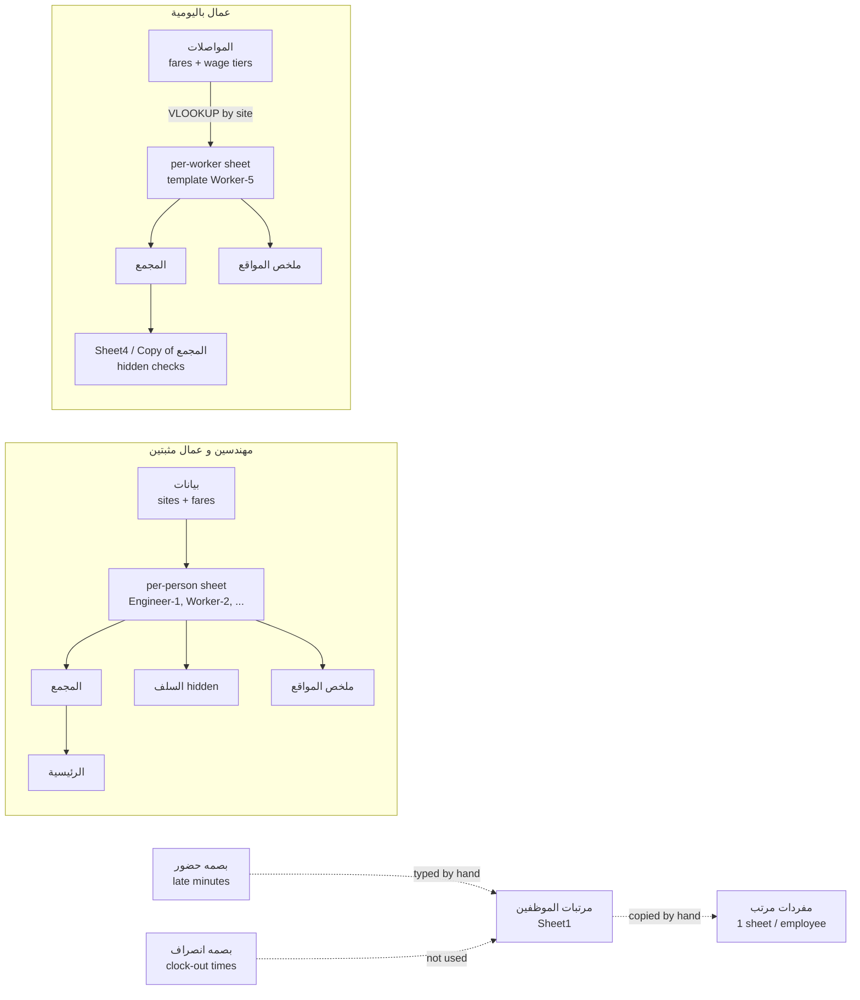

# Smart Tech — Excel Payroll System Analysis

Employee names are replaced with labels (Engineer-N, Worker-N, Person-N) to keep personal data out of the repository.

Source: the 6 workbooks in the project root, read cell by cell (values + formulas). Period covered: October 2026.

## 1. Overview — three payroll populations

| Population | Workbook | Pay basis | Cycle |
|---|---|---|---|
| Office staff (موظفين مثبتين شركة), ~27 | `مرتبات الموظفين مثبتين شركة شهر10.xlsx` + payslips `مفردات مرتب شهر 9 مثبتين شركة.xlsx` | Monthly salary | Month |
| Engineers & permanent site workers (مهندسين و عمال مثبتين), ~26 | `مهندسين و عمال مثبتين بالشركة شهر 10.xlsx` | Monthly salary + daily timesheet | 26th → 25th |
| Day laborers (عمال باليومية), 240 slots, ~91 paid this period (only 36 rows carry a code) | `مرتبات العمال باليومية من 1-10-2026 حتي 15-10-2026.xlsx` | Daily wage looked up by site + wage tier | Half month (1–15, 16–end) |

Fingerprint files `بصمه حضور شهر 10.xlsx` (check-in) and `بصمه انصراف شهر 10.xlsx` (check-out) relate to office staff only.

## 2. Office staff

### 2.1 Fingerprint — check-in (`بصمه حضور`, Sheet1)
- Rows = employees (English names: Person-1, Person-2, Person-3…). Columns B→AE = days 26-9 → 25-10 (headers for 1–12 Oct are stored as dates Jan-10…Dec-10 — day/month swapped).
- Cell value = **late minutes** for that day, entered as arithmetic: `=42-15` (minutes late minus a **15-minute grace**), `=60+33` (1h33m).
- Running subtotals overwrite day columns: `H = SUM(B:G)`, `O = SUM(H:N)`, `V = SUM(O:U)`, `AC = SUM(V:AB)` — cumulative lateness per week.
- `AF` اعفاء (exemption), `AG = AE − AF` صافى التأخير (net lateness). AE/AF are empty, so AG = 0 for everyone.

### 2.2 Fingerprint — check-out (`بصمه انصراف`)
Raw clock-out times (12-hour, e.g. 5:00, 4:20). No formulas; nothing references it. Used only by eye (early leave).

### 2.3 Salary sheet (`مرتبات الموظفين مثبتين شركة شهر10`, Sheet1)

| Col | Arabic | Meaning / formula |
|---|---|---|
| B | المرتب الاساسي | Total monthly salary (input) |
| C | زيادة | Raise (input) |
| D | المرتب بزياده | `= B + C` |
| E | مرتب الاساسي | Insured basic (2700 / 2800 / 3000, or 0 if not insured) |
| J | بدلات وحوافز | `= D − E` → incentives part of salary |
| F, G | عدد ايام السفر / بدل سفر | `G = F × S` (one day's pay per travel day) |
| H, I | عدد ايام البرج / بدل انتقالات البرج | `I = H × S / 4` (quarter day per tower day) |
| K | التامينات الجديده | Social insurance (input, empty) |
| L | ضريبة كسب العمل | Income tax (input, 0) |
| M | السلف | Advances repaid (input) |
| O | خصم اهمال | Negligence deduction (input) |
| P, Q, R | التاخير / الاعفاء / صافي التاخير | Late minutes typed by hand, exemption, `R = P − Q` |
| S, T, U | اليوم / الساعه / الدقيقه | `S = D/30`, `T = S/8`, `U = T/60` |
| V | خصم تاخير | `= U × R` (1× minute rate) |
| W, X | الوقت الاضافى / الاضافى | OT minutes, `X = (S/8/60) × W × 1.5` |
| Y, Z | ايام غياب / خصم غياب | `Z = Y × S` |
| AB | مكافأت | Bonus / end-of-service (input) |
| **AD** | **الصافي** | **`= B + G − K − L − M − O − V + X − Z + AB + I`** |
| AA, AC, AE | ملاحظات | Last working day, received date, "تم التحويل" (transferred) |

Rules implied: month = 30 days, day = 8 hours; OT ×1.5; absence = full day; lateness 1× minute rate. Note AD uses **B** not D, so raises (C) are not paid through the net.

Leavers are settled here: Y = days not worked, AB = end-of-service bonus (e.g. Person-4: 24 absence days, 28,000 bonus → 30,800 net).

### 2.4 Payslips (`مفردات مرتب شهر 9`)
One sheet per employee (22 + 2 blank templates). Header: company, company insurance no. 2836522, employee full name, insurance no., national ID, bank account.

| Line | Value copied from salary sheet |
|---|---|
| الراتب الأساسي | E (insured basic) |
| حوافز | J (= D − E) |
| مكافأة / بدل سفر / وقت أضافى / بدل انتقالات | AB / G / X / I |
| تأخير / سلفه / غياب | V / M / Z (in the deduction column) |
| اجمالى الراتب | `additions − deductions` |

Values are typed, not linked. The payslip shows the salary split as **insured basic + incentives**.

## 3. Engineers & permanent workers workbook (34 sheets)

### 3.1 بيانات (master data)
- Per person: residence (السكن: العامرية, الاسكندرية, كفر الدوار) × site (الموقع) → transport fare (المواصلات), e.g. Worker-3 from العامرية to دمنهور = 45.
- Master list of sites `AD73:AD100` (دمنهور, جوار, انربك, … Filmar, MOD-10 Ramadan, أجازة رسمية) — used as dropdown source.

### 3.2 Per-person sheet — engineer template (Engineer-1, Engineer-2, Engineer-3, Engineer-4)
Header: name, basic (`E6`), title `C2 = "تفصيلي راتب 10-2026"` (every sheet references `Engineer-1!C2` and `Engineer-1!A8:A38` for the dates).

Daily rows 26-9 → 25-10:

| Col | Meaning | Formula |
|---|---|---|
| B / D | In / out time | input |
| C / E | Site (ملاحظات) | input from site list |
| F | أضافى خارج الاسكندريه (minutes outside Alex) | input |
| G | Late minutes | input |
| H | OT minutes | input |
| I | Advance taken that day | input |
| J | Day's extra money | `= m×H×1.5 − m×G×1.5 + m×F`, where `m = basic/30/8/60` |
| K | Day cost | `= basic/30` |
| L | Total day cost | `= J + K` |
| M | Site | `= C` |

Totals: `H6 = ΣJ`, `I6 = ΣI`, net `J6 = basic + ΣJ − ΣI`. Bottom block: الاساسي, الاضافي, السلفة, الخصم → `الاجمالي المستحق = basic + OT − advance − deduction`.

### 3.3 Per-person sheet — worker template (Worker-1, Worker-2, Worker-3, Worker-4, …)
- `E2` hourly rate `= basic/30/8`; `C2` = 8 working hours; `U3/V3` scheduled 08:00–16:00.
- Per day: scheduled in `C`, actual in `D`, scheduled out `F`, actual out `G`.
  - Hours worked `J = IF(G−D > 0, G−D, 1−D+G)` (handles night shifts).
  - Late `K = D − C`; late cost `L = K × hourly × 24 × 2` (**double** rate).
  - OT hours `M = IF(J×24 > 8, J − 8/24, 0)`; OT money `O = M × 1.5 × hourly × 24 + I` (I = outside-Alex money).
  - Day cost `Q = basic/30`, `R = O + Q`.
- Transport helper block (T–AA): السكن, الموقع, مواصلات كاملة, نص مواصلات (full / half fare).
- Summary: `K5` basic, `L5` lateness, `M5` OT, `N5` advances, `O5 = M5 + K5 − N5 + L5`.

### 3.4 المجمع (consolidated payroll)
One row per person, pulling from the person sheets: الاساسي (C), الاضافي (D), السلف (E), الخصم (F), التأخير (G), غياب (H). `I = C + D − E − F − G − H`. Row 27 = `SUBTOTAL(9, …)` totals → basic 260,500, OT 80,129, net 315,451.

### 3.5 الرئيسية (dashboard)
- Totals card: salary / OT / allowances / advances / deductions / net, linked to `المجمع!C27…I27`.
- "إستعلام" lookup: type a name in `K53` → `INDEX(المجمع!col, MATCH(K53, المجمع!B5:B13, 0))` shows that person's figures.

### 3.6 السلف (advances ledger, hidden)
Rows = days of the month, column triplets per person: سلفة (pulled from the person sheet's advance column), سداد (repayment, typed), الرصيد (`= advance − repayment`).

### 3.7 ملخص المواقع (site job-costing)
Matrix of ~70 sites/leave types (rows) × people (columns): `SUMIF(person!site_col, site, person!day_cost_col)`; `AB = SUM(row)` = labor cost per site (e.g. الجمعة leave 23,567, صواري 16,783). Leave types (اجازة الجمعة, اجازة رسمية, اجازة مرضي, غ = absent) are treated as "sites", so paid leave cost is visible too.

### 3.8 المجمع (2) / (3)
Hidden older copies of the consolidated sheet.

## 4. Day-laborers workbook (252 sheets)

### 4.1 المواصلات (master rates)
- **Top area (rows 1–90)**: per-worker blocks of residence → site → transport fare (e.g. from كفر الدوار to جوار = 35).
- **Site list** `M94…` and **wage-tier tables** from row 93: ~40 blocks, each with columns `site | daily wage | بدل (allowance) | extra`. Tier labels: عامل, عامل عادي, عامل عالي, مساعد عالي. Daily wages range **175 → 420 EGP** (e.g. Q:T = 330 "عامل عالي", U:X = 260 "عامل عادي", FF:FI = 420).
- Allowance per site is a formula of the wage: Alex Apparel `= wage × 0.25`; Nestlé Sharm El-Sheikh `= wage × 2` (`× 3` in one tier); most sites 0.

### 4.2 Per-worker sheet (template `Worker-5`)
Title `B1` = period text, referenced by every sheet. Rows 9–24 = days of the half month.

| Col | Meaning | Formula |
|---|---|---|
| B | المكان (site) | input |
| C | اليومية (wage) | `IFERROR(VLOOKUP(B, المواصلات!<tier table>, 2, FALSE), 0)` |
| D | البدل (allowance) | same VLOOKUP, column 3 |
| E | المواصلات (transport) | VLOOKUP into a transport table, column 4 |
| F, G | OT minutes / OT money | `G = (C/8/60) × F × 1.5` |
| H, I | Late minutes / late money | `I = (C/8/60) × H × 2` |
| J | Day total | `= C + D + E + G − I` |
| K | السلف | input |

Summary column N: wages `N8`, allowance `N11`, advances `N13`, deductions `N16`, OT `N20`, lateness `N24`, transport `N27`, **`N30 = N8 + N11 − N13 − N16 + N20 − N24 + N27`**.

The worker's **wage tier is chosen by which table the VLOOKUP points to** (e.g. Worker-6 → `EV94:EX300`, 390/day). A non-working day (اجازة الجمعة, غ) is not in the table → wage 0. Some sheets have an extra column (layout shifted by one), so references differ per sheet.

### 4.3 المجمع (consolidated)
240 rows: م, الكود, الاسم, المهنة (فني / م. فني …), اليومية, البدل, المواصلات, الاضافي, مكافآت, `J = SUM(E:I)`, الخصومات, السلف, التأخير, `N = J − K − L − M`. Row 245 totals: wages 311,835, allowance 58,055, OT 34,946, advances 11,950, lateness 937 → **net 391,948 EGP** for 1–15 Oct.

### 4.4 Other sheets
- **ملخص المواقع**: same SUMIF site-costing matrix for 79 workers (`SUMIF(sheet!B9:B24, site, sheet!J9:J24)`).
- **Sheet4** (hidden): mini card per worker from المجمع.
- **Copy of المجمع / Copy of المجمع 1** (hidden, period 16–31 Oct 2023): reconciliation — pasted previous figures in `N`, `O = (M = N)` TRUE/FALSE check.
- **ردود النموذج 1** (hidden): empty Google Forms responses sheet.
- ~145 hidden worker sheets = former workers, kept so references don't break.

## 5. How the creator uses the files (workflow)

1. **Office staff lateness**: export fingerprint data → type late minutes per day as `=minutes−15` → read the weekly running totals → type the result into the salary sheet column P. Check-out file is only looked at.
2. **New period**: copy last period's workbook, change one title cell (`Engineer-1!C2` or `Worker-5!B1`) and the date column on the first sheet; all other sheets inherit it.
3. **Daily entry** for engineers/workers: for each person and each day type the site (from the site list), in/out times or OT/late minutes, and advances. Wage, allowance, transport, OT and late money calculate automatically.
4. **Rates** live in one place (`بيانات` / `المواصلات`): changing a site's wage or fare changes all workers on that tier.
5. **Consolidation**: المجمع pulls every person's totals → الرئيسية dashboard and the bank/cash payment list. ملخص المواقع gives labor cost per site (for client billing / project costing).
6. **Leavers**: hide the sheet; settle on the salary sheet (absence days + end-of-service bonus).
7. **Payment**: print per-person sheet (signature line "توقيع مدير الشركة"), print payslips for staff; remarks record "تم التحويل" (bank) or "استلام نقدى" (cash).

## 6. Errors and risks found

| # | Where | Problem |
|---|---|---|
| 1 | Staff salary `B29:E29` | `SUM(B2:B29)` includes itself → circular, totals show 0 |
| 2 | Staff salary `AD` | Net uses B (basic) not D (basic + raise) — raises never paid |
| 3 | Sept payslip `J13` | `SUM(J5:K12)` adds deductions to the net (fixed in the Oct Person-5 payslip with `D − G`) |
| 4 | Worker template `O5` | `= M5 + K5 − N5 + L5` **adds** lateness; المجمع subtracts it separately — inconsistent nets |
| 5 | Engineers المجمع row 20 | Person-6's advances/deductions point to Person-7's sheet |
| 6 | Engineer-2 `F37` | 666.67 EGP holiday bonus typed in a *minutes* column → paid 925.93 |
| 7 | Engineer-1 rows 14–38 | Formulas replaced by pasted values; day cost 370.97 = 11,500/31 (another person's salary) |
| 8 | الرئيسية, السلف | `#REF!` (deleted allowance column; days 26–31 refs) |
| 9 | Fingerprint headers, worker dates | 1–12 Oct stored as Jan–Dec 10; mixed text/date cells |
| 10 | Day-laborers المجمع `G245` | `SUBTOTAL(9, G5:G229)` stops 15 rows short of other columns |
| 11 | Check-in Person-8 `H19` | `SUM(B19:J19)` overlaps into the next week |
| 12 | All files | No formula link between fingerprint data and payroll; staff payslips typed by hand |
| 13 | Lateness rules | Three different penalties: staff 1×, engineers 1.5×, workers 2× |
| 14 | Day-laborers المجمع rows 100, 227, 232, 238 | Read another worker's sheet (e.g. L100 Worker-7 → Worker-8's advances); row 119 is all `#REF!` |
| 15 | Site names | Same site spelled differently across workbooks and inside one (سموحة الدولي/الدولى, العلمين/العالمين, فندق الشيراتون/الشراتون, trailing/double spaces). ENG ملخص المواقع misses الشيراتون (21 days), `#REF!` (33), اجازة (1) |
| 16 | Fares | 30 of 99 residence × site pairs have different fares for different workers; the `بيانات` fare blocks are not referenced by any formula, and day-laborer transport is 0 for every row in October |

## 7. Implied data model for the HRMS

- **Employee**: type (staff / engineer / permanent worker / day laborer), job title, residence, wage tier, salary, insured basic, insurance no., national ID, bank account, active / left date.
- **Site**: name, city (inside / outside Alexandria), per-site allowance rule.
- **WageTier × Site**: daily wage, allowance.
- **Residence × Site**: transport fare (full / half).
- **AttendanceDay**: employee, date, site or leave type, scheduled in/out, actual in/out, late minutes, OT minutes, outside-city minutes.
- **Advance**: date, amount, repayment, balance.
- **PayrollPeriod**: monthly (calendar or 26→25) or half-month.
- **PayrollLine**: basic, incentives, travel, transport, allowance, OT, bonus, insurance, tax, advance, negligence, lateness, absence, net, payment method.
- **Rules**: 30-day month, 8-hour day, OT ×1.5, 15-min grace, lateness multiplier per employee type.

## 8. Corrections from the second read (2026-10-16)

- **Wage tiers are flat wages.** The 41 tables in `المواصلات` (row 93+) each hold one daily wage for every site (175 → 500), except leave rows and a few site exceptions. Labels are inconsistent (عامل عالي covers 325–500). The same wage appears in several tables, and 21 sheets take the wage from one table and the allowance from another. The HRMS stores a daily wage on each worker instead (`docs/adr/0002-daily-wage-on-worker.md`).
- **Allowance depends on the site**: wage × 0.25 at Alex Apparel and السعودي الالماني, × 2 at Nestlé Sharm (× 3 in some tables), × 1 at القاهرة in some tables.
- **Fares are per worker.** `بيانات` (ENG) has 6 per-worker blocks and `المواصلات` (DAY) 31. Worker sheets keep their own typed fare table at T7:Z (e.g. Worker-2 الاسكندريه→دمنهور 20 full / 10 half vs `بيانات` 22). Residences: كفر الدوار, الاسكندرية, العامرية, دمنهور (+ الاسكندرية - الورديان).
- **People move between workbooks**: Person-9 (ENG hidden → DAY paid), Person-10 (DAY hidden → ENG paid), Person-11; Person-7 may be two people.
- **No manager, hire date, phone or department** in any workbook. National ID, insurance no. and bank account exist only on the payslips.
- **Fingerprint names** map to the salary sheet for 25 of 27; Person-12 and Person-13 are uncertain.
- **Office shift** is not written anywhere; check-out times cluster at 5:00 PM, consistent with the client's 09:00–17:00.
- **Day-laborer advances** are typed on the day given and deducted in full the same half-month; no balances carry forward.
