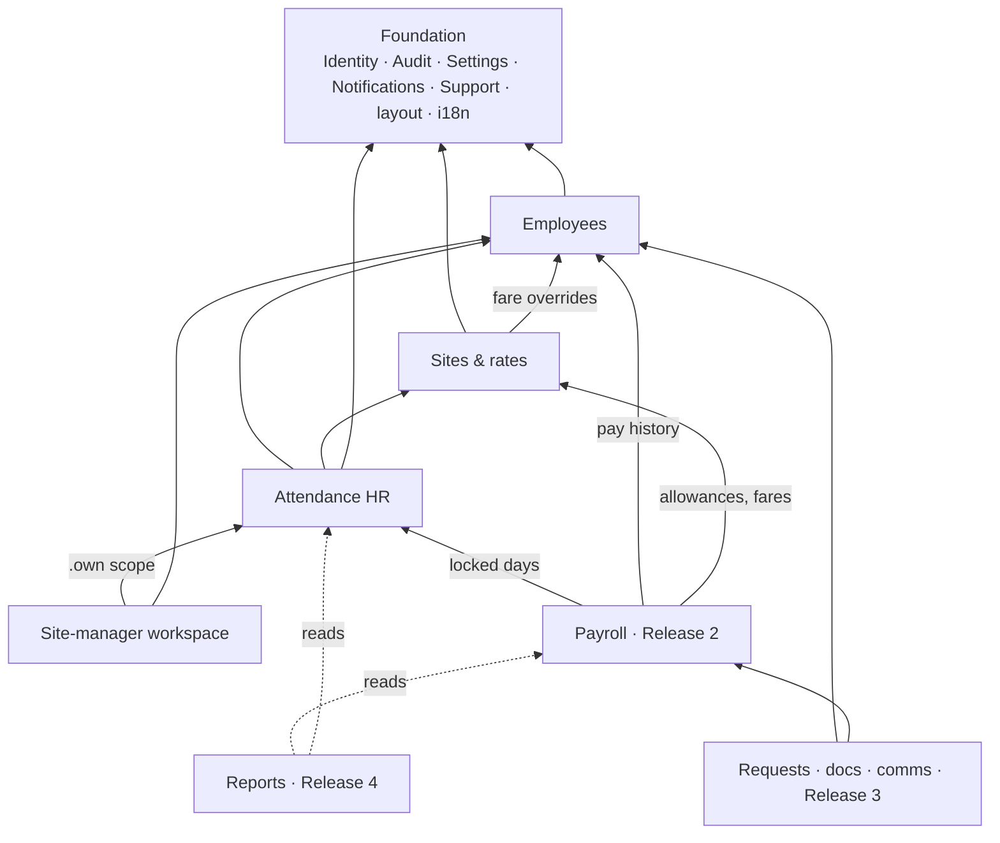

# Smart Tech HRMS — 4-Month Module Plan

## Context
Smart Technology runs HR and payroll today on 6 hand-built Excel workbooks (analysed in `docs/excel-system-analysis.md`) and has a front-end-only demo (https://github.com/mr-h12/HRMS-DEMO, React 19 + Vite, mock data). Goal: a production HRMS built by 2 full-stack devs in 4 months, delivered as 4 monthly production releases. It runs standalone now, with an API ready for integration with the company's Laravel CRM later. This plan splits the system into modules so the client knows what lands when.

## Settled decisions (from grilling)
| Topic | Decision |
|---|---|
| Team / delivery | 2 full-stack devs; 4 monthly releases, each goes straight to production |
| Stack | Mirror the CRM (`docs/adr/0001-mirror-crm-stack.md`): Laravel 13 / PHP 8.4, PostgreSQL 17, Redis, `/api/v1`, UUIDv7, modular + deptrac, PHPUnit, CRM-style RBAC + audit log, browsershot PDFs. Frontend: the demo's look + react-i18next |
| Hosting | Client's on-prem server, delivered as **Docker**. ⚠️ **Backups are NOT set up: manual until the owner confirms. Keep this warning visible in the release notes and the developer console.** |
| Language | Arabic + English (RTL/LTR) |
| Users | 7 accounts: 1 CEO, 1 HR, 5 managers. **No employee or worker accounts.** Developer role can add accounts |
| Roles | Developer (super-admin) > CEO > HR > Manager. HR can edit everything a manager enters |
| Data entry | Manager records attendance, absence, lateness, leave and requests for the people on their sites; attendance is HR-only for now (see Attendance entry (1c)) |
| Approvals | Manager → HR → (HR decides) CEO, or HR approves alone |
| HR alerts | Instant for requests, warnings and edits to past days; daily digest for routine attendance |
| Fingerprint | Office staff only; HR uploads the device's Excel export; 15-min grace; shift 09:00–17:00 (per-employee override); import flags missing punches / early leave / OT, HR confirms. Office attendance is HR's, not the managers' |
| Payroll types | Office staff (monthly), engineers/permanent workers (26→25), day laborers (half-month). Lateness/OT multipliers are settings per type (1× / 1.5× / 2×, OT 1.5×) |
| Rates | Day laborer's daily wage on the worker (effective-dated, `docs/adr/0002-daily-wage-on-worker.md`); site allowance rule per site; residence × site fare + per-worker override. Permanent workers' transport is paid (full/half per day) |
| Leave | <1 year on Jan 1 → 10 days, ≥1 year → 21, of which 6 casual (both). Year from Jan 1, no carry-over; crossing 1 year mid-year alerts HR. Day laborers: none. Leave pay and request rules: `docs/superpowers/specs/2026-11-03-leave-design.md` (owner, 2026-11-03; L1–L3 are defaults until the client answers questions 8–10). All values are settings |
| Insurance / tax | Manual: HR types employee share, company share and income tax per employee per period; blank = 0. Insured basic only splits the payslip |
| End-of-service | System suggests ½ month × years × last total wage; HR edits (rule pending client) |
| HR override | System computes everything; HR can override any computed value (reason, highlighted, survives recompute, revertible) |
| Rounding | None, as in the Excel; NUMERIC(18,6), display 2 dp |
| Advances | HR chooses one payment or installments for every advance |
| Weekly off | Per type: office Fri + Sat, field Fri; paid for monthly staff |
| Payout | Mark "paid" + HR writes how it was received. No bank files |
| HR notes | On employee profile, visible to HR + CEO, optional reminder date |
| Signing | Manager marks "signed" for the employee (electronic) or uploads a scanned paper copy. HR/CEO saved signature images are stamped on approval |
| Communication | HR picks the recipient (manager or employee). Channels: in-app to manager, email, and a wa.me WhatsApp button. Every message is logged on the employee file. WhatsApp API → phase 2 |
| Migration | Everything extractable from the Excel files; history imported as-is, with a **warning flag beside each known error** (the 16 in the analysis doc) |
| Period lock | Locked after HR close + CEO approval; only HR can reopen, with a reason (audit-logged) |
| Extra demo modules | Recruitment, performance, training and assets are IN scope as lite versions (no applicant portal, no self-review) |
| Attendance entry (1c) | For now HR alone records attendance, for every employee type including office staff. The manager screen is a later item (Release 1, item 5). HR gets a day sheet per group and date with bulk marking (cohort sweeps, ID lists, ranges, paste) and a session undo; the period grid stays |
| Attendance day | One record per employee per day: one site or one leave day-type (office staff: present, with no site, or a leave day-type). A second site goes in the note. Absent (غ) is a leave day-type, never a flag. A day with no record is missing, never absence |
| Attendance dates | HR enters or edits any day of an open period up to today (Cairo time). No future dates |
| Attendance periods | Per group: office the calendar month, engineers and permanent workers the 26th → 25th, day laborers 1–15 and 16–end. The attendance lock is per (group, period) |
| Attendance lock | HR locks one group's period in one action, after confirming the missing days; nobody edits until HR reopens with a reason. Weekly off days and official holidays are derived on read while the period is open and stored at lock. ⚠️ (owner) HR may lock a period before it ends. Reopening keeps the stored derived days. Deleting or moving a holiday removes its stored days on the old date; weekly-off days are not refreshed; the re-lock lists the holiday changes and the leave days on a holiday (owner, 2026-11-04) |
| Official holidays | A holiday is a named period of consecutive days (from, to; at most 31), not only one date. Existing holidays became one-day periods; holidays never overlap, and a weekly off inside one is the holiday. Adding, editing or deleting needs every group's periods on all its old and new days open (owner, 2026-11-10; `docs/calculations.md` §2a) |
| Attendance concurrency | Each day carries a `version`; a write with a stale version returns `409 concurrency_conflict`, never an overwrite. Days are never hard-deleted; clearing a day is an audited update |

## Modules by release

### Release 1 — end of Month 1: Foundation & daily operations
1. **Auth**: email + password, sessions. Passwords are set and changed only by the Developer role (no self-service reset or change).
2. **Developer console**:
   - RBAC: create roles and edit permissions per role.
   - Account management.
   - Audit-log panel (who did what, before/after values).
   - Error & request/response log screen: done (`/console/logs`, Developer only via `system_log.view.all`).
   - Retention: 1 year for audit, 90 days for request/error logs: done by `logs:prune` (daily 03:00 Cairo).
3. **Employees**:
   - Auto sequential code; optional `crm_user_id`.
   - Type (office / engineer / permanent worker / day laborer), with dated type history.
   - Identity: national ID, insurance no., gender, address, fingerprint name (English, for matching).
   - Pay: pay method (bank / cash) + bank account, salary + raise, insured basic, daily wage (day laborers), shift override.
   - Placement: department, residence, home site (workers), manager (engineers; office reference).
   - Contract dates, document expiry dates, hiring-documents checklist, termination date + reason.
   - HR notes.
4. **Sites & rates**: sites (deduplicated from both workbooks), leave day-types, site allowance rules, residence×site fares + per-worker overrides, manager↔sites assignment.
5. **HR attendance (1c)**: HR records every employee type for now, per employee per day:
   - Site or leave day-type; office staff are present or on a leave day-type.
   - The fields of the employee's type (in/out times, late / OT / outside-Alexandria minutes or amount, transport, advance amount, note).
   - The Excel template: download, fill, upload with a preview, confirm.
     The template is a grid like HR's timesheet: one row per employee, one column per day, and the site or day type in each cell. Times, overtime and advances stay in the app **(owner, 2026-10-20)**.
   - Official holidays, kept in Settings.
   - The attendance lock per group and period; HR reopens with a reason.
   - The missing-days bell. Job `attendance:alert-missing` runs at 21:00 Cairo time and notifies the users holding `attendance.edit.all`:
     - Input: the date.
     - Idempotent on (user, type, date), so a re-run is a no-op.
     - 3 tries with 60 s / 300 s backoff, on the `maintenance` queue.
     - Failures are logged. The counts are cumulative, so the next run covers a failed day.
   - Later, separate items:
     - **Manager mobile screen**: the manager enters today, and yesterday until 12:00; older days are HR-only. «زي امبارح» quick fill; the manager's own sites only; the «تم التوقيع» sign-off per employee period, after which only HR edits; HR returns a period with a notification to the manager; an alert to HR when a manager skips a day.
     - **Paste site attendance messages**: HR pastes a site's attendance message in a fixed format, and the system parses it per person.
6. **Leave**: balances and rules above, recorded by the manager, HR approves or escalates. Built in 6 slices per `docs/superpowers/plans/2026-11-03-leave.md`.
7. **Notifications**: in-app, instant + daily digest.
8. **Migration step 1**: step 1 (master data: employees, sites, rates, fares) is done by `hrms:import-master`; opening leave and advance balances follow their modules.

### Release 2 — end of Month 2: Payroll
1. **Fingerprint import** (office) → late minutes with grace, exemptions.
2. **Payroll engines** for the 3 types, reproducing the Excel formulas (section 2.3 / 3.2–3.3 / 4.2 of the analysis doc).
   - The configurable multipliers above.
   - Known Excel bugs fixed in the engine (e.g., raises included in net), and an **Excel-difference report** (employee, amount, reason) the client signs off: one Arabic document for October 2026, generated from the regression test (owner, 2026-11-09).
   - HR override on every computed value.
   - **Status: built** (PR B, branch `claude/payroll-engines`, 2026-11-12; spec `docs/superpowers/specs/2026-11-09-payroll-engines-design.md`): the three engines; the payroll sheet per group and period, computed on read, with HR's entry and overrides (API `/api/v1/payroll`, page «المرتبات», permissions `payroll.view.all` and `payroll.manage.all`); the fields of item 4; the October 2026 regression and `docs/reports/2026-10-excel-differences.md`. Not built: the advances ledger (item 3: until then the advances are those logged on attendance days, or typed on an office entry, deducted in full), payroll close and its read-only period (item 5: the sheet stays editable after the attendance lock), payout (item 6), the payslip PDF (item 7), the historical archive (item 8), the fingerprint import (item 1, on hold) and site-costing screens.
3. **Advances/loans ledger**: amount, installments, repayment, balance.
4. **Social insurance + income tax**: manual HR fields (permanent only). Built with item 2: HR's entry for monthly staff holds the employee share, the company share and income tax; blank = 0.
5. **Period close**: HR closes → CEO approves → lock / HR reopen.
6. **Payout**: paid flag + how received.
7. **Payslip PDF** (template: مفردات مرتب).
8. **Migration step 2**: historical payroll archive (read-only) with error flags.
9. **Parallel run** against Excel starts this month and continues through Month 4.

### Release 3 — end of Month 3: Requests, documents, communication, lifecycle
1. **Request workflow** (manager on behalf of the employee → HR → optional CEO). Types: leave, late permission, early leave, advance, resignation. Effects on approval:
   - Late permission cancels that day's lateness deduction.
   - Leave deducts from the balance.
   - Resignation opens offboarding.
2. **11 PDF templates** (Arabic, auto-filled from the employee profile, HR/CEO signature stamping, "signed" mark or scanned upload):
   - job offer
   - إذن تأخير (late permission)
   - طلب انصراف باكراً (early-leave request)
   - طلب إجازة (leave request)
   - استقالة (resignation)
   - إنذار (warning)
   - استلام خط موبايل (mobile-line receipt)
   - إخلاء طرف (clearance)
   - شهادة خبرة (experience certificate)
   - مكافأة نهاية الخدمة (end-of-service bonus; amount entered manually)
   - مفردات مرتب (payslip; delivered in Release 2)
3. **HR communication center**:
   - Message types: congratulation, condolence, alert, warning, PDF.
   - Recipient: manager or employee.
   - Channels: email, wa.me button, in-app to manager.
   - Every message logged on the employee file.
   - Group send: HR filters employees (by site, manager or type) → the system shows their WhatsApp numbers and the message text, with copy buttons, for pasting into a WhatsApp broadcast list. It can also open each chat in turn (one wa.me per employee, HR presses send). No unofficial bulk-sending tools.
4. **Date-reminder engine**:
   - Lead time configurable per date type: contract end 30 days, probation end 14 days, ID/licence/permit expiry 30 days, document deadline from the job offer, return from leave, insurance forms, note reminders.
   - Shown on the HR dashboard, as a notification and by email.
5. **Custody register**: mobile line, devices, etc. Clearance is blocked until every item is returned.
6. **Onboarding**: job offer → documents checklist → 90-day probation review.
7. **Offboarding**: resignation/termination → clearance → final settlement → experience certificate.
8. **Attendance sign-off upload**: the scanned paper sign-off of an attendance period, stored with the employee's documents.

### Release 4 — end of Month 4: Talent, reports, hardening
1. **Recruitment (lite)**: jobs, pipeline Applied → Hired, interviews.
2. **Performance (lite)**: manager rates employees per cycle.
3. **Training (lite)**: courses, enrolment, completion.
4. **Assets**: extends the custody register with categories and statuses.
5. **Reports + CEO dashboard**: headcount, attendance, leave, payroll, turnover, **site labor cost** (from ملخص المواقع), Excel/PDF export.
6. **API documentation** for the future CRM integration.
7. **UAT, final Excel-parity sign-off, handover** (last 2 weeks).

## Risks / to tell the client
- ⚠️ **Backups are manual and not configured.** The client must confirm before we automate them.
  Employee document files live in `backend/storage/app/private`: copy that folder with every DB dump. Replaced and deleted files are never purged, so it only grows.
- **Tight scope for 2 devs.** The talent modules ship as lite versions in Month 4. If anything slips, they move first, never payroll.
- **We need from the client:** remote access (VPN/SSH) to the on-prem server, plus an SMTP mailbox on the company domain. Without remote access, each release needs a site visit.
- **Rates:** the site-dependent hourly rate is unconfirmed. The rate table supports both a fixed and a per-site rate.
- **Historical data** carries the Excel errors. They are flagged, not corrected.

## Verification (per release)
- **Release 2 parity:** re-run October 2026 from the migrated data and compare with the Excel totals: engineers net 315,451, day laborers net 391,948. Every difference must trace to a documented Excel error.
- **Role matrix test:** each of Developer / CEO / HR / Manager sees and can do only what its permissions allow. A manager sees only their own employees.
- **Audit log:** every create/update/delete and approval shows an entry. Errors appear on the error screen.
- **PDFs:** each of the 11 templates renders correctly in Arabic and matches the client's Word layout.
- **Reminders:** create test dates → alert fires at the configured lead time.
- **Deployment:** `docker compose up` on a clean Linux VM reproduces production before each release.

## Client revision 1 (received 2026-10-31)
Source: `hr-module-edits.pdf`, the client's 23-item Arabic list (2 pages), sent after using the Release 1c build. **Status: draft.** No item has been confirmed with the owner yet, so nothing below changes a settled decision until the owner answers `docs/client-questions.md` § Client revision 1. The PDF is not committed: keep client documents out of the repo.

Status is verified against `main` at `7be93b9` (PR #3 merged) by reading the code. No gate was run for this review. **Status key:** ✅ done, 🟡 partial, 🔁 built but must change, ❌ not built, ❓ needs a decision first.

### Gap analysis
| # | Client asks (paraphrased) | Status | What the code does today | Affects |
|---|---|---|---|---|
| 1 | The period table (جدول الفترة) is too complicated | 🔁 ❓ | Period grid: employees × days, and a click opens the single-day editor (`frontend/src/pages/attendance.tsx:82`). It has no selection and no bulk action. The client gives no detail on what is hard. | Attendance |
| 2 | Edit shared fields of several employees at once | ❌ ❓ | `PATCH employees/{id}` edits one employee. There is no bulk endpoint or bulk UI. | Employees |
| 3 | Upload document copies as image or PDF | ✅ | HR uploads, views, replaces, edits and deletes files from the Documents tab (PDF/JPG/PNG/WEBP, 10 MB, photos shrunk); managers see the list only; the received date was removed (owner, 2026-11-03). Spec: `docs/superpowers/specs/2026-11-03-employee-documents-design.md`. | Employees |
| 4 | Show HR notes in the outer table, full text on hover | ✅ | Settled by Q6 (2026-11-03). The list returns `hr_notes` only to `employee.view.all` viewers (`EmployeeService::summary`); the employee list shows a notes column (from md; under the name on phones) only when the response carries notes, one line with the whole note on hover and on tap or Enter, which never opens the employee (`NoteCell`, `frontend/src/pages/employees.tsx`). Tests: `ManagerScopeTest` (a site manager gets no notes), `EmployeesApiTest::test_the_ceo_receives_hr_notes_in_the_list_and_the_profile`. The reminder date is still not built. | Employees |
| 5 | The system is still slow | ❓ | PR #2 (perf architecture) is merged. No measurement exists from the client's server. The known slow path is the import: about 8 queries per changed cell (`AttendanceImport.php:165`). | Foundation |
| 6 | Move between rows with ↑/↓ and make the current row obvious | 🟡 | The day sheet already moves a cursor row with ↑/↓ and J/K and draws a ring on it (`attendance-sheet.tsx:40,263`, `attendance-sheet-rows.tsx:163`). The period grid has no row cursor. The client may mean the grid, or find the ring too faint. | Attendance |
| 7 | A way to record arrival and leaving times | 🟡 ❓ | Office: in and out times. Permanent workers: scheduled and actual times. Engineers: optional times, used in no calculation. Day laborers: no times (`Attendance/Domain/DayRules.php:16-18`). The day sheet edits only the office in-time inline. | Attendance |
| 8 | Lateness computed automatically | 🟡 🔁 | Computed for office (grace applied) and permanent workers (`DayRules::officeLateMinutes`, `workerMinutes`). Engineers and day laborers type late minutes, an owner decision in the 1c spec ("typed as in the Excel"). | Attendance, calculations.md |
| 9 | Default the site to the last one entered; the user can change it | 🟡 | `last_site_id` is the latest work site in the 7 days before the date (`AttendanceGrid.php:169`). The day sheet's "present" action uses it; the day editor does not prefill it. | Attendance |
| 10 | Excel attendance per site: auto-fill, HR reviews, and an alert listing what is missing with a count | 🟡 🔁 | The template is per group and period, keyed by employee code, one site or day type per cell (amended G1–G9). Its preview lists changes and errors but not missing days. There is no per-site file. The client's own site sheets (for example the Sheraton sheet HR keeps) have not been analysed. | Attendance |
| 11 | Every input restricted to its format, for example phone = 11 digits starting 01… | 🟡 | Phone done per Q8: `^01[0125]\d{8}$`, text, shared by the API and the master import (`EmployeeRules::MOBILE`), with an Arabic and English message; the form uses a numeric keypad, Arabic digits become ASCII, 11 characters at most. ⚠️ Before deploying, list the stored phones that fail the rule on a database copy: the edit form sends every field, so an employee with such a phone cannot be saved until it is fixed. Other free-text fields (insurance no., bank account) still have no format rule: R6 named only the phone. | Employees, all forms |
| 12 | The manager also has attendance | ❌ ❓ | Managers are user accounts. `employees` has no link to `users`, so a manager has no attendance row unless HR also creates them as an employee. | Identity, Employees |
| 13 | An "all employees in the system" option | ❓ | Every attendance view is per employee type, because periods differ per type. Where "all" is wanted (sheet, grid, filter, bulk edit) is not stated. | Attendance |
| 14 | Quick entry by employee name instead of number | 🔁 | `parseBatch` writes only for ID batches; a name search only selects, by design (`frontend/src/lib/day-sheet.ts:22`, "it must never write"). | Attendance |
| 15 | Mark a selection present, enter one arrival time, take late people out and give them their own time | 🟡 | Bulk "present" exists; office in-time is per row. There is no batch time dialog and no "remove the late ones" list. | Attendance |
| 16 | An area (منطقة) above sites, used as a filter and defaulted from the last site | ❌ | Sites have no area or grouping (`2026_10_17_000001_create_sites_tables.php`). | Sites |
| 17 | Rename manager to team lead (مسؤول التيم); simple, fast phone screens; research voice entry | ❌ | **Name settled 2026-11-04 (Q1): site manager (مدير الموقع), not team lead.** Managers have no attendance permission yet; the manager mobile screen is listed above as a later item. Permissions are checked by name, so a rename is a label and locale change, not a role-slug change. Voice entry needs a research spike. | Site-manager workspace |
| 18 | In the period table, select several employees and several days and enter attendance together | ❌ | `POST attendance/days/bulk` takes one `date` per call (`AttendanceController::bulk`, `AttendanceDays::BULK_FORMAT`). The grid has no selection. | Attendance |
| 19 | Drop the employee number or make it a hidden key; number employees 1…N, CEO = 0 | ✅ ❓ | **Owner answered 2026-11-03 (R5):** the ID stays visible and HR edits it. `PATCH employees/{id}/code` (permission `employee.edit_code.all`, HR and Developer; an `.own` grant is refused) takes any number from 0 up to the highest ID ever issued (422 `code_above_highest` above it); an ID a live employee holds is refused (409 `code_taken`, naming them) unless HR swaps the two, in one transaction against the now deferrable `employees_code_unique`. **Numbers are never reissued (owner, 2026-11-03):** new employees get the highest ID ever issued + 1 from `employee_code_counter`, so renumbering the top employee down does not free their number, and a deleted employee's ID is not reused. The attendance import refuses a row whose ID now names someone else (`code_name_mismatch`); editing an employee's Arabic name after a download refuses that employee's rows in the old template too (download a fresh one). **Default pending the owner:** everyone is not renumbered at once. | Employees, Attendance |
| 20 | The manager enters day laborers only | 🔁 ❓ | The current rule (CLAUDE.md) is that a manager acts for all of their own employees, every type. | Identity/RBAC, Site-manager workspace |
| 21 | The manager enters the day laborers' hourly rate | 🔁 ❓ | Conflicts with ADR 0002: a day laborer has an effective-dated **daily** wage, set by HR through a pay change. Hourly pay and manager-set pay both change the payroll model. | Employees, Sites & rates, Payroll |
| 22 | Pay closes every 15 days for some people and every 30 for others | 🟡 ❓ | Today the period follows the type: day laborers 1–15/16–end, everyone else monthly. Payroll is not built. Is the cycle per type (as today) or per employee? | Payroll |
| 23 | When pay closes, who receives the details, and what details? | ❓ | Not built and not specified; the client asks this too. | Payroll, Communication |

### What this changes in earlier decisions
- **Attendance entry (1c) "HR alone records attendance"**: items 17, 20 and 21 bring the manager screen forward and narrow it to day laborers. The "today only" rule recorded above still stands until the owner says otherwise.
- **"A name must never write" in the day sheet**: item 14 asks to write by name. This needs a rule for ambiguous names (two employees match) before it is built.
- **Lateness typed for engineers and day laborers**: item 8 may reverse this. Automatic lateness for them needs scheduled times per type (settings) and a multiplier review in `docs/calculations.md`.
- **ADR 0002 (daily wage on the worker, set by HR)**: item 21 may require an hourly rate, and lets a manager set pay. If confirmed, write a new ADR. Do not edit 0002.
- **Employee ID**: settled 2026-11-03 (R5): `code` stays visible and HR may edit or swap it one employee at a time, to any free number from 0 up to the highest issued. Numbers are never reissued: a new hire gets the highest ever issued + 1. An attendance template downloaded before a change of ID or Arabic name is refused row by row for that employee (`code_name_mismatch`; download a fresh one); paper references and old Excel files keep the old number. Not renumbering everyone is a default until the owner says otherwise.
- **Managers are accounts, not employees**: item 12 needs a link between an account and an employee record.

## Owner decisions of 2026-11-03
**Status: decided** by the owner, answering eight questions. They settle the rows above that they name; the follow-up questions are R18–R29 in `docs/client-questions.md`. The table above was checked at `7be93b9`. Only the rows this section names were re-checked at `5604078` (PR #10 merged). The others may be out of date after PRs #6–#10, and no gate was run.

### Decisions and what they change
| # | Decision | Code at `5604078` | Change needed | Module |
|---|---|---|---|---|
| Q1 (items 17) | **Site manager / مدير الموقع** is the domain and UI term (owner, 2026-11-04; it replaces Team lead / مسؤول التيم, chosen 2026-11-03). One or more per site, as built (ADR 0004). Keep the `manager` slug, assignments and permissions. | Renamed in #18 (`9ce8ad2`): the role's display name (its migration), `site.managers`, `perm.site.assign_manager` and the sites' validation attribute. Kept on purpose, because they also name an engineer's or an office worker's manager: `employee.tab.manager`, `manager.*` and the audit entity `employee_manager_assignments`. | None. `CONTEXT.md` done. | Foundation (locales), Site-manager workspace |
| Q2 (item 19) | Employee ID stays visible; **0 is the CEO's**; never reused; UUID stays the key; name search is the normal way to select. | Allocator in `EmployeeService::create` locks `employees` (`SHARE ROW EXCLUSIVE`) and takes `greatest(employee_code_counter.last_issued, max(code)) + 1`, so a deleted or renumbered-down code is never reissued; `employees_code_unique` (deferrable) backs it. **0 is not reserved**: `changeCode` accepts any free number from 0. | Done (2026-11-06, R23): 0 marks the CEO, with no separate flag; `changeCode` gives it only while no one holds it and refuses any swap onto or off it (`errors.code_zero_ceo`). Make sure the counter table always has exactly its one row. If it were empty, numbering would restart at 1: the unique index refuses any code a live or soft-deleted employee holds, but a code whose row was hard-deleted could be issued again. | Employees |
| Q3 (item 21) | Workday **09:00–16:00** for the three field types, set by HR in Settings (R19, 2026-11-04; was 08:00–16:00 on 2026-11-03); ADR 0002 daily wage stands; no hourly pay; HR owns wages; site managers never set or see wages. Partial-day pay is open (R25). | The shared field shift `worker_shift_end` became **17:00** in `2026_11_02_000001_set_field_shift_end.php`, for engineers, permanent workers and day laborers alike. Site managers (`.own` scope) get no pay fields from `EmployeeService::show` (`$full` false). | R19 answered 2026-11-04: the field shift is **09:00–16:00** for the three field types, set by HR in Settings at rollout (no migration; never edit the 2026-11-02 one). No wage access for site managers is already true; keep a test for it. | Settings, Attendance |
| Q4 (item 12) | A site manager can be an employee and an account holder; optional account-to-employee link; HR records and reviews their attendance; permissions and pay stay separate. | No link between `users` and `employees`. | A nullable, unique link (owned by Employees, read by Identity), set by HR. Attendance needs no change: the site manager is an ordinary employee row. | Employees, Identity |
| Q5 (item 22) | Pay cycles **by type**, no per-person setting: day laborers 1–15 / 16–end; others keep their monthly cycles. | `Attendance/Domain/Period` has these periods per type. | None now. Verify each monthly cutoff before payroll (R26). | Payroll |
| Q6 (item 4) | HR notes in the employee list, **HR and CEO only**, preview with full text on hover or tap; enforced on the server. | `hr_notes` is in `EmployeeService::SENSITIVE`, stripped for own-scope callers, and not a list column. | Add it to the list response for `.all` viewers only, plus a test that a site manager's list and detail responses contain no notes. | Employees |
| Q7 (item 14) | Search by name → explicit pick → add to batch → apply to save. Show ID and site for duplicates. No auto-save, even for one match. | `parseBatch` (`frontend/src/lib/day-sheet.ts`) writes ID batches only; names only select. | A name picker that adds to the batch. The "a name never writes on its own" rule stays. | Attendance |
| Q8 (item 11) | Egyptian mobile only, `^01[0125]\d{8}$`, stored as text. | `phone` accepts any string (`'nullable', 'string'`, `EmployeeRules.php:54`); the master import keeps it as text (`MasterDataImport::TEXT`). | **First** list the stored phones that fail the pattern, on a copy of the production database. Then enforce the rule in `EmployeeRules` and the form. WhatsApp normalising (`+20…`) is separate, in Release 3. | Employees |

### Lateness deduction (`docs/calculations.md` §0a)
- **Rule:** a 15-minute grace a day, then chargeable minutes × wage ÷ divisor × the **type's** multiplier: office 1, engineers 1.5, permanent workers 2, day laborers 2 (2026-11-06, R27; it replaces the per-employee multiplier decided 2026-11-03). Divisors: 14,400 for monthly staff, 480 for day laborers. The wage is the one in force in the system. No EGP-per-minute amount is imported.
- **Evidence (`معاملات_خصم_التأخير_لكلود.xlsx`, given 2026-11-03; reference only, not committed, because it names employees):**
  - 306 rows: 274 extracted, 32 need review.
  - Office: 27 rows, all ×1.
  - Monthly site staff: 27 rows, 25 extracted (6 at ×1.5, 19 at ×2), 2 to match. Re-checked 2026-11-06 against the workbook's formulas: every ×1.5 is an engineer-template sheet and every ×2 a worker-template sheet, so the value follows the type.
  - Day laborers: 252 rows, 222 at ×2 (divisor 480), 30 to match.
  - 4 names appear twice. Rows are source records, not unique employees. Each is matched to an Employee ID by HR before use; a blank multiplier means unresolved, not 0.
- **Conflicts with the earlier spec:**
  - Multipliers stay per type, as in `CLAUDE.md` and `excel-system-analysis.md` item 13 (2026-11-06). The per-employee rule of 2026-11-03 is withdrawn.
  - The field types had no grace; now every type has one.
  - Both can move the October fixtures (engineers 315,451; day laborers 391,948). Explain every difference in the Excel-difference report, and do not edit a fixture to make a test pass.
- **Where the multiplier lives:** the existing per-type settings (`lateness_multiplier_office`, `_engineer`, `_permanent_worker`, `_day_laborer`; seeded 1, 1.5, 2, 2). No field on the employee, and no matching of the multipliers workbook to employee codes.
- Absence, early leave and overtime keep their own rules. The absence formula is verified for office staff only (R21).

### Other decisions recorded
- **Roles:** HR administers the system, manages employee records, rates and site assignments, and reviews and corrects attendance. Site managers record attendance and absences for their site teams and never see wages. HR and the General Manager review and approve Releases 1–2.
  - "HR handles accounts": decided by R22 (owner, 2026-11-08). HR creates accounts and sets passwords for HR and team-lead accounts, not for the Developer or the CEO.
  - ⚠️ "General Manager" may or may not be the CEO, and the CEO's account already sees every employee's current pay: R28.
- **Advances:** the approval is on paper; the system records the request and prints it. Approval, disbursement (the advance amount on a day, or a ledger entry) and repayment (installments) stay separate records. ⚠️ This changes Release 3 item 1, which listed "advance" as an in-app request type.
- **Forms:** the existing Word and PDF forms print as PDFs in their planned release. Releases 1–2 come first: employees and sites, attendance and leave, then payroll, fingerprint import, advances and payslips.
- **Migration:** a full historical migration is no longer assumed. Release 2 item 8 (the historical payroll archive) and the parity re-run from migrated data wait on R29 (go-live date, opening balances, archive or not).
- **Transport:** separate from the wage. Fares and site allowances are never part of the lateness wage basis (§0a). The fare's dependence on residence, actual site and override stays as in `calculations.md` §4.
- **Transport fare (2026-11-05, option C, replaces option A):** HR sets every fare (the residence × site default, plus per-worker overrides) from the team transport page, per team lead, and fills a missing residence there, engineers included; with `site.manage` a residence not yet in the list is added from the same dialog (owner, 2026-11-08). The team lead reads their own team's fares and never sets fares or sees wages. Engineers get a fare only by override; a day laborer with no fare gets 0. Spec: `docs/superpowers/specs/2026-11-05-team-lead-fares-design.md`.

### Site manager's day: owner decisions of 2026-11-05 (PR #22 review)
- **Open day:** a field day (engineer, permanent worker, day laborer) with an arrival and no departure; office never. The site manager records no later day for that person until it is completed. Past the yesterday window they may still add the departure only, until the period is locked; the arrival and the status stay. Audited, and HR can correct it.
- **Proposed wage:** approved as built. The site manager types a proposed number and never sees a stored wage; HR sets the wage on approval. The new laborer's gender is entered with them and stays required.
- **Refused laborer:** HR's refusal ends the laborer that day (an earlier end HR already set stays) and takes them off every crew from that day and off any earlier day with nothing recorded, so the yesterday window adds no new day; one audited transaction. Days already recorded stay for HR to decide (pay a wage for those days, or cancel them); nothing is deleted automatically.
- **Crew:** a one-day add, move or removal is approved as built; the home site stays HR's. The search takes the exact code or the full name and returns at most one laborer.
- **Notifications:** at once for a proposed wage and for a departure entered after the window (an edit to a past day); crew changes and open days as counts in the 21:00 alert (`attendance:alert-missing`), never as separate notifications.

### HR's site filter across attendance: owner decisions of 2026-11-08

- **The filter** shows on the day sheet and the period grid, for every group, to a user holding all-scope attendance (`attendance.view.all`). The day sheet also offers «بدون موقع» for rows with no site.
- **Office staff get a dated site that HR sets**, stored like a worker's home site. It only lists them at the site in this filter: no site manager reach, no pay, no fare, no site costing. Engineers cannot hold one.
- **Where an employee is on a date** (each sheet row's `site_id`): the day's stored work site; else, for workers and office staff, their site on the date; else, for every type, their last site (office staff have none); else none. A day laborer taken off every crew for the date has no site that day, whatever their last site.
- **All on the day sheet** lists every type, each read in its own period, for reading only: Details on each row, quick recording stays inside a single group. Its day strip is the engineers' window and shows no missing count, since a count per date across different pay periods would be wrong.
- **All on the period grid now includes office staff.** With a site, it lists who has a stored day there in the period, plus the office staff at that site on the period's last day.
- **A row with no site** offers «تحديد الموقع» to a holder of `employee.assign_site`, for office staff and workers. Engineers have no such button.

### Payroll engines: owner decisions of 2026-11-09
Answers before Release 2 item 2. Formulas: `docs/calculations.md`; spec: `docs/superpowers/specs/2026-11-09-payroll-engines-design.md`.
- **Review findings first:** M1 (dated changes accepted inside a locked period; a type change not starting at a period boundary) and M2 (a pay change drops insured basic, raise and shift override) from `docs/reviews/2026-11-08-release-1-review.md` are fixed in their own PR before any engine code, because payroll reads those records. The other findings stay debt.
- **Insurance and tax (question 11):** typed by HR per employee per period (employee share, company share, income tax); blank = 0; nothing carries over.
- **Rounding (question 12):** none, the net included; paid as computed, shown to 2 decimals.
- **Excel-difference report (question 13):** one Arabic document for October 2026, generated from the October regression test; each line names the employee label, the amount and the Excel error number or decision behind it. The client signs it once before go-live. No comparison screen.
- **Midnight (question 14):** lateness does not wrap around midnight.
- **Overtime start (question 20):** after the shift end, not after 8 h worked. Permanent workers' OT = actual out − scheduled out; engineers' and day laborers' OT stay the minutes HR approves, with the hint from the shift end.
- **Absence (R21):** غ days deduct days × salary ÷ 30 for every monthly type; a day laborer earns no wage that day.
- **Early departure / half day (R25):** no automatic deduction for any field type; payroll flags the minutes and HR deducts by hand with a reason.
- **Engineers' transport:** the per-worker fare override, in full, on every day worked at a work site; none without an override.
- **Wage approval in a locked period (owner, 2026-11-11):** HR's approval of a site manager's proposed wage (`DayCrew::decide`) writes the daily wage from the hire date (else the proposal's date) even when that date falls in a locked attendance period, although M1 refuses other dated changes there. Accepted as built: no lock check, no code change (`docs/client-questions.md` question 21).

### Hidden archived employees: owner decisions of 2026-11-11
An archived employee (termination date before today in Cairo) has left the company. Spec: `docs/superpowers/specs/2026-11-11-hide-archived-employees-design.md`.
- **Attendance:** hidden by default from every attendance screen, for every role. HR (`attendance.edit.all`) has one switch on the period grid, «إظهار من تركوا العمل» (`with_archived=1`), off by default, to finish and lock their last days. Recorded days are never deleted; the lock, its missing list and the import still include them.
- **Who reaches them:** only all-scope viewers (`employee.view.all`), through the Archive view, on a read-only page (data, attendance, leave, document download) with an «مؤرشف» banner. Its only actions are Reactivate and correcting the termination date or reason. A site manager sees neither the Archive switch nor any archived employee.
- **Open items:** a termination date is refused while the employee has a pending or escalated leave request or a pending wage proposal (`employee_has_open_items`, 409, which lists them). Whatever slips through stays visible to HR until decided. Advances and custody join this rule when built.
- **API by id:** a site manager is refused everything about an archived employee (one rule in `EmployeeReach`). For all-scope users reads are allowed; writes to the archived employee's record are refused (`employee_archived`, 409) except reactivating, correcting the termination date or reason, attendance days up to the termination date, and deleting. Deciding or cancelling a leave request and deciding a wage proposal stay allowed.
- **Reactivating** brings everything back.
- **History:** old notifications and the audit log stay as they are; no new alert counts an archived employee.

### Changes to the work plan
- **Youssef:**
  - Add R19 (workday) to the attendance contracts. The shift default changes in one new migration, after R19 is answered.
  - The name picker (Q7) replaces order 4's "quick entry by name".
- **Second developer:**
  - WP-B1 gains the phone check on a database copy (Q8), the server-side notes rule (Q6) and the CEO-only 0 (Q2; R23 answered 2026-11-06: 0 is the CEO's alone).
  - The account-to-employee link (Q4) is a new small PR in Employees, before the site-manager workspace.
- **Third developer (Payroll):** builds §0a with the multiplier per type. R26 and R27 are answered (2026-11-06), R21 and R25 on 2026-11-09.

## Modules, ownership and parallel work
**Status: proposal.** Owner approval needed. Developer names are the current team: **Youssef**, who built Releases 1a–1c, and **the second developer**, who joins now. A third developer may join later.

### Module map
The backend already splits into modules (`backend/app/Modules/*`, layers enforced by `deptrac.layers.yaml`); the map keeps them and adds the missing ones. A module owns its tables, its `/api/v1` routes and its frontend pages.

| Module | Responsibility | Owned code and tables | Exposes to others | Depends on |
|---|---|---|---|---|
| **Foundation** (shared) | Auth, RBAC, audit, settings, notifications, the API envelope, money and time helpers, layout, routing, i18n setup, the form kit | `Identity`, `Audit`, `Settings`, `Notifications`, `app/Support`; `users`, `roles`, `permissions`, `role_permissions`, `audit_log`, `settings`, `notifications`; `routes/api.php`, `frontend/src/App.tsx`, `components/layout/*`, `components/form.tsx`, `components/ui/*`, `lib/*` | `permission:` middleware, `RequestScope`, `Audited`, `BusinessRules`, `Notifier`, `useList`/`useApi`/`useSave` | none |
| **Employees** | Employee record, type and pay history, manager assignment, documents and their files, HR notes, field validation, employee ID policy, bulk edit, master-data import (PR #4) | `Employees`; `employees`, `employee_type_changes`, `employee_pay_changes`, `employee_documents`, `employee_manager_assignments`; `pages/employees.tsx`, `pages/employee-documents.tsx` | `EmployeeRoster`, `EffectiveDated::at` (type, pay, shift on a date), `isManagedBy` | Foundation |
| **Sites & rates** | Sites, leave day-types, areas (new), residences, fares, allowance rules, manager↔site | `Sites`; `sites`, `residences`, `fares`, `employee_fare_overrides`, `site_allowance_rules`, `manager_sites`; `pages/sites.tsx`, Settings tabs for sites, residences and fares | `SiteService`, `FareLookup`, site and area lists | Foundation, Employees (fare overrides) |
| **Attendance (HR)** | Attendance days, period grid, day sheet, Excel template and import, locks, official holidays, missing-day alert | `Attendance`; `attendance_days`, `attendance_locks`, `official_holidays`; `pages/attendance*.tsx`, `pages/holidays.tsx`, `lib/day-sheet.ts` | `effectiveDay`, the period definition (`Domain/Period`), the locked-period read used by payroll | Foundation, Employees, Sites |
| **Site-manager workspace** (new) | The site manager's phone screens: today's entry for their own day laborers, last-site fill, sign-off, day-laborer rate entry if confirmed, voice spike | New frontend pages (`pages/team/*`); `attendance.*.own` permissions in a new migration; no tables of its own (it writes through the Attendance API) | none | Attendance (`.own` scope on the existing endpoints), Employees, Sites |
| **Payroll** (Release 2) | Pay periods and close, engines, advances, insurance and tax fields, payout, payslip | New `Payroll` module and tables | Locked-period results for reports | Attendance (locked days), Employees (pay history), Sites (allowances, fares), Settings |
| **Requests, documents and communication** (Release 3) | Request workflow, 11 PDF forms, messages, reminders, custody, on- and offboarding | New modules | none | Employees, Payroll (for settlement), Foundation |
| **Reports** (Release 4) | Dashboards, site costing, exports | New module | none | Everything above; reads only |

### Shared files and their single owner
These files cause most merge conflicts. Only the owner merges a change to them; anyone else edits them only in a small PR the owner reviews.

| Shared area | Owner | Rule |
|---|---|---|
| `routes/api.php` | Youssef | Each module adds its routes in its own `Route::prefix(...)` block; don't reorder other blocks. Splitting the file per module is a separate Foundation PR, made only if conflicts keep happening. |
| `frontend/src/App.tsx`, `components/layout/AppLayout.tsx` (routes, nav) | Youssef | One line per new route or nav entry, added at the end of its group. |
| `frontend/src/locales/ar.json`, `en.json` | Youssef | Keys are namespaced by module (`employee.*`, `attendance.*`, `team.*`). Add keys only inside your own namespace, in both files (the parity test enforces it). |
| Migrations (`backend/database/migrations`) | Each table's module owner | Always a **new** migration, never an edit to one that ran. Name it with the full time (`Y_m_d_His_…`) so two developers on the same day never share a prefix. A migration touches only its module's tables, plus its own permission and setting rows. |
| Permissions and settings seeding | Youssef reviews | Add permissions in the feature's own migration, following `2026_10_20_000001_create_attendance_tables.php`. Add new setting keys to `SettingController::RULES` in the same PR. |
| `components/form.tsx`, `components/ui/*`, `lib/query.ts`, `lib/api.ts` | Youssef | A change to a shared component's props is its own small PR, merged before the feature that needs it. |
| `CONTEXT.md`, `docs/hrms-module-plan.md`, `docs/calculations.md`, `docs/client-questions.md` | The developer whose PR changes the rule | Update in the same PR as the code; the other developer reviews. |

### Contracts to settle before parallel work starts
1. **Employee ID (R5).** Whether `code` stays visible decides the template, search, quick entry and PR #4. Answer first. Answered 2026-11-03: it stays visible and HR may edit it (item 19).
2. **The site-manager scope (R1–R4).** This decides the `.own` permissions, and whether managers need an employee record.
3. **The bulk-day contract.** Change `POST attendance/days/bulk` from one `date` to per-row dates (or add a range form), keeping the version-based 409. Youssef proposes the request and response shape in a short PR description, the second developer agrees, then it is built. The site-manager workspace builds on it.
4. **The document-file contract.** Storage disk, maximum size, allowed MIME types, who may download, and whether a file version is kept on replace. Answered 2026-11-03 by `docs/superpowers/specs/2026-11-03-employee-documents-design.md`.
5. **PR #4 (master-data import).** Merge or close it before the second developer touches `EmployeeController.php` or the Sites controllers; it rewrites their validation.

### Allocation for two developers
Each developer delivers whole features inside their own modules.

- **Youssef: Foundation, Attendance (HR), Sites & rates.** Youssef built these, and items 1, 6–10, 13–16 and 18 live here.
- **Second developer: Employees, then the site-manager workspace.** Items 2, 3, 4, 11, 12 and 19 are in Employees and touch no attendance file. The workspace (17, 20, 21) is a new folder of pages on top of the Attendance API, so it rarely conflicts with Youssef's work.

**First work package for each developer** (both start once the contracts above are agreed):
- **Youssef, WP-A1: period-grid bulk entry (items 18, 6, 1).** The bulk-day contract above (multi-date rows), cell and row selection in the period grid, ↑/↓ row cursor with a visible highlight, and one bulk action bar shared with the day sheet. Tests: multi-date bulk with a stale version → 409 for that row only; locked period refused; audit entry per day.
- **Second developer, WP-B1: employee input rules and HR notes in the list (items 11, 4).** Format rules on every employee field, in the backend validation and in the form (phone format per R6). An HR-notes column in the employee list with the full text on hover and on tap for phones; visibility per R7. Tests: each rule refuses a bad value with an Arabic message; a manager doesn't see notes unless R7 says so.

**Then, as a sequence of small PRs:**
| Order | Youssef | Second developer |
|---|---|---|
| 1 | WP-A1 bulk contract + grid selection | WP-B1 validation + notes column |
| 2 | Batch arrival-time dialog with late removal (15); last site prefilled in the editor (9) | Document file upload (3), after the file contract |
| 3 | Areas on sites + area filter (16) | Employee bulk edit of the fields agreed in R8 (2) |
| 4 | Quick entry by name, after the ambiguity rule R11 (14); automatic lateness if R10 confirms it (8) | Employee ID change per R5 (19), coordinated with Youssef because the template and quick entry read `code` |
| 5 | Site-sheet import with a missing-days summary (10), after HR's real site sheet is analysed (R13) | Site-manager workspace: `.own` permissions, today's entry for own day laborers, phone layout (17, 20) |
| 6 | Performance pass with measurements from the client's server (5, R15) | Day-laborer rate entry if R4 confirms it (21, needs a new ADR); voice-entry spike (17) |

### Integration checkpoints
- **After each PR:** the other developer reviews it. Every gate in `backend/CLAUDE.md` and `frontend/CLAUDE.md` passes on the branch.
- **After order 1:** a joint check of the bulk contract from both UIs (grid and day sheet).
- **Before order 4's employee-ID PR:** both developers agree the migration and template change together, because it crosses modules.
- **Before the site-manager workspace merges:** a role-matrix test run (Developer, CEO, HR, site manager), and a browser check at 375 px as a site manager.
- **Before a release:** the owner approves from screenshots (375/1024/1440, ar/en, light/dark), as the 1c slices did.

### Branch and worktree workflow
- One branch per work package from the latest `main` (`feature/<module>-<topic>`, for example `feature/attendance-grid-bulk`, `feature/employees-validation`). A PR into `main`; the other developer reviews; the owner merges.
- Keep a separate `git worktree` per open branch, so switching tasks never mixes uncommitted work. Each worktree needs its own `backend/.env`, and a separate Docker project name (`COMPOSE_PROJECT_NAME`) with its own ports if two stacks run at once.
- Rebase on `main` before asking for review. If `main` gained a migration with a later timestamp than yours, re-date your unmerged migration file so the order stays chronological.
- Never force-push a shared branch.

### Adding a third developer
Give the third developer **Payroll (Release 2)**: new tables and a new module that only *reads* Attendance (locked days), Employees (pay history) and Sites (allowances, fares), so it barely touches files the other two edit. It can start once these are fixed: the pay-cycle answer (R16), the locked-period read contract from Attendance, and the October 2026 regression fixtures in this plan. If payroll must wait for answers, the third developer takes the Requests module (Release 3) instead, starting with the request workflow, which also only reads from Employees.
